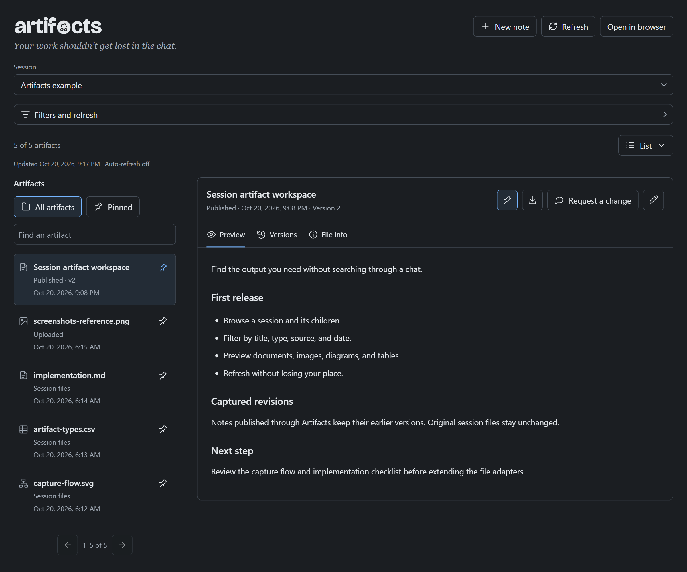
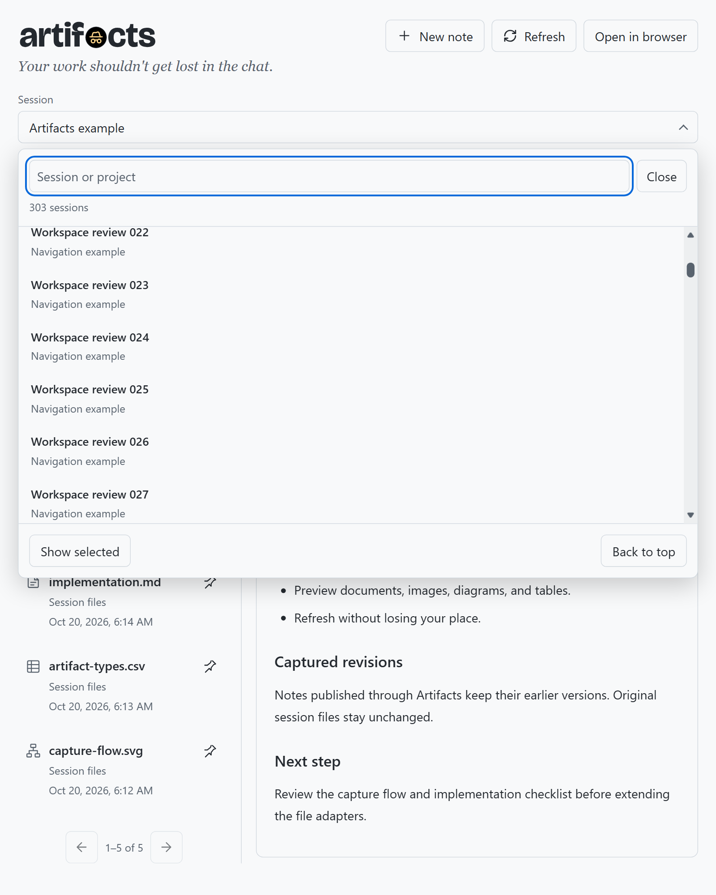

<p align="center">
  
</p>

Files get buried in long chats. Artifacts brings them together so you can find what you made, take a closer look, and keep the pieces you need.

<a href="screenshot.png"></a>

## Install

Paste this into a GitHub Copilot app chat:

```text
Install or update Artifacts as a persistent personal canvas extension from:
https://github.com/likamrat/ghcp-canvas-apps/tree/main/apps/artifacts

Preserve existing notes, revisions, and pins. Reload extensions, verify that
Artifacts appears in Canvas apps, and open it.
```

## Use

Choose a session, then open an artifact. Pin files you want to keep handy, search the list, or switch to Gallery or Timeline. Filters start collapsed.

Create notes, revisit their saved versions, or download a file. **Request a change** prepares text to copy into Copilot chat; it does not send a message.

Your files stay local and unchanged. Version history covers notes saved through Artifacts, not earlier versions of discovered files.

<a href="screenshot-dark.png"></a>

<a href="screenshot-sessions.png"></a>
