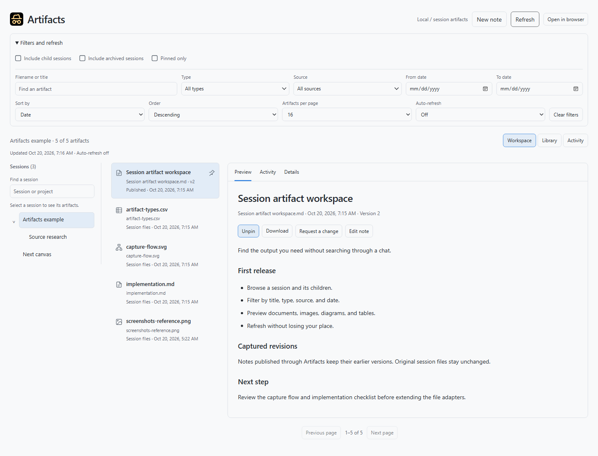

<p align="center">
  
</p>

Find the documents, images, and files from a Copilot session without searching through its chat. Artifacts keeps source details beside each output and saves revisions of notes published through the app.



## Install

Artifacts runs as a personal canvas extension in the GitHub Copilot app. Paste this into a chat:

```text
Install or update Artifacts as a persistent personal canvas extension from:
https://github.com/likamrat/ghcp-canvas-apps/tree/main/apps/artifacts

Reuse an existing installation and preserve its notes, revisions, and pins.
Reload extensions in the GitHub Copilot app and verify Artifacts appears
in Canvas apps as "Canvas · Personal" with "New session".
If you cannot inspect that list, say so. Then open Artifacts.
```

## Use

Opens with the current session selected. Choose another session in the navigator or include its child sessions.

- **Workspace** puts the artifact list beside a reader. **Library** shows file cards and image previews. **Activity** lists artifact references by date. All three use the same filters.
- Filter by filename or title, type, source, date, or pinned status. Type and Source accept multiple selections. Selections within a filter are combined; different filters narrow the results together.
- Sort by date, filename, or size. Activity switches to date sorting. Browse 8, 16, or 32 artifacts per page.
- **Refresh** reads the selected scope again. **Auto-refresh** starts off and supports 5, 10, or 30 seconds, 1 minute, or 5 minutes. It pauses while hidden and preserves filters, selection, and page when they still apply.
- Select an artifact to preview it, inspect its source, pin it, or download it. Images and SVG diagrams have zoom controls. CSV and TSV files open as tables.
- **New note** saves Markdown in Artifacts. **Edit note** saves another revision. Earlier captured revisions remain readable; original session files are unchanged.
- **Request a change** prepares a request to copy into Copilot chat. Selected document text is included. The canvas does not send messages to an agent.

**Open in browser** uses your system browser. Closing the canvas leaves that view running. Keep its Copilot session active; reloading extensions ends the old browser connection.

## Data

Local only. Reads the app's session metadata without changing it, then checks supported file references and session artifact folders. Remote files are not fetched. Missing files stay visible when a reference is retained.

Pins, published notes, and their revisions are saved in the app's own SQLite catalog under `$COPILOT_HOME/extensions/artifacts/artifacts/`, or `~/.copilot/extensions/artifacts/artifacts/` when `COPILOT_HOME` is unset. Removing or overwriting an original file does not create a recoverable revision. Revision history applies only to notes published through Artifacts.

Dates use local time and identify whether they came from a session event, file metadata, or publication. A tool reference means a tool used the file; it does not prove the tool created it. Discovery limits and inaccessible sources appear under **Discovery notes**.

Text previews are limited to 1 MiB and binary reads to 32 MiB. Table previews show up to 200 rows and 32 columns. Markdown supports headings, lists, checklists, links, and fenced code. Raw HTML in notes is displayed as text. PDF and Office files can be downloaded but do not have an embedded document editor.

## Agent actions

The canvas exposes `list_sessions`, `query_artifacts`, `get_artifact`, `read_artifact`, `register_artifact`, `list_revisions`, and `set_pinned`.

`register_artifact` publishes Markdown to a local session. Updating a published note requires its ID and expected version. `read_artifact` returns bounded text pages; image bytes are not included.

## Develop

Node 24+. No build step or package installation. From this folder:

```sh
node --test model.test.mjs render.test.mjs refresh.test.mjs server.test.mjs source.test.mjs store.test.mjs extension.test.mjs
```

For a standalone browser view of real local data:

```sh
node server.mjs <session-id>
```

Open the local URL printed by the server. After changing an installed copy, reload extensions in the GitHub Copilot app and reopen browser tabs. Cross-app browser, filter, and branding checks are in `tests/`.

The wordmark uses Bricolage Grotesque and replaces the second **a** in **artifacts** with Lucide's [hat-and-glasses icon](https://lucide.dev/icons/hat-glasses). See the [font license](FONT-LICENSE.txt) and [Lucide license](LUCIDE-LICENSE.txt).
