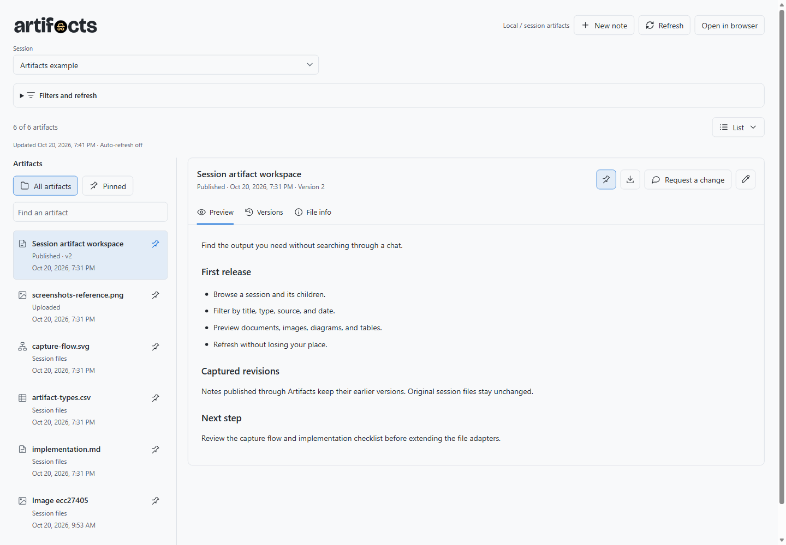
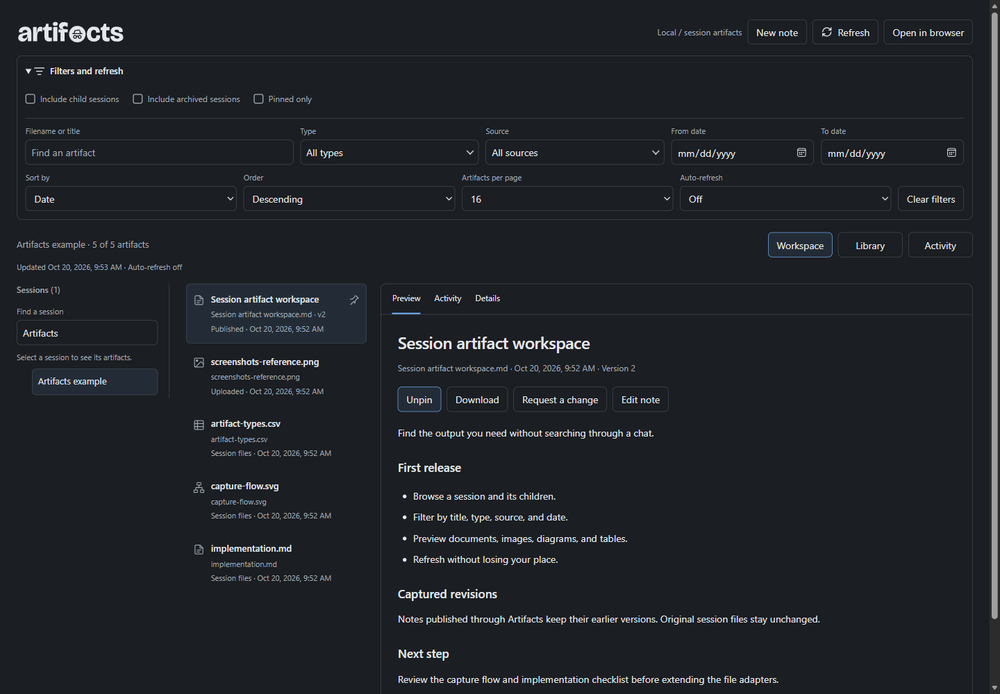
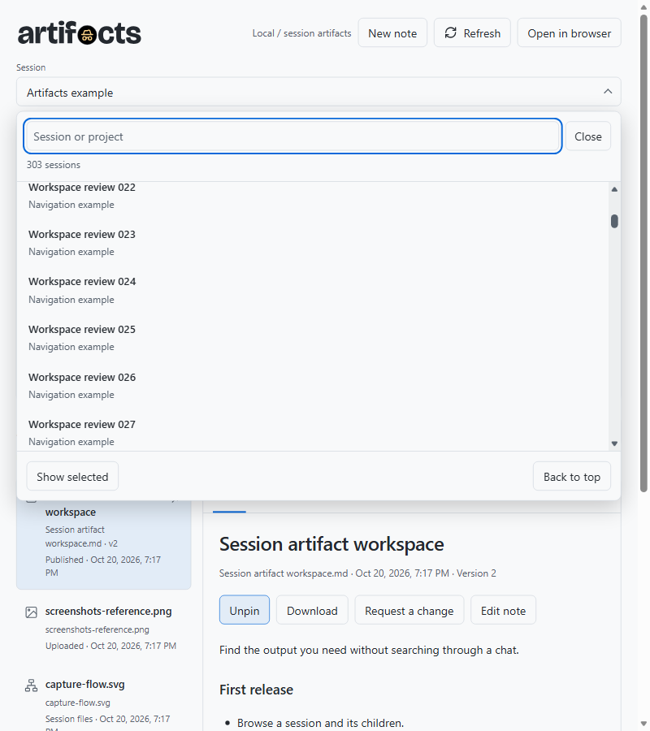

Files get buried in long chats. Artifacts brings them together so you can find what you made, take a closer look, and keep the pieces you need.



## Install

Paste this into a GitHub Copilot app chat:

```text
Install or update Artifacts as a persistent personal canvas extension from:
https://github.com/likamrat/ghcp-canvas-apps/tree/main/apps/artifacts

Preserve existing notes, revisions, and pins. Reload extensions, verify that
Artifacts appears in Canvas apps, and open it.
```

## Use

Choose a session, then open an artifact. Pin files you want to keep handy, search the list, or switch to Gallery or Timeline. Filters start collapsed.

In the canvas or browser view, click an image preview to open it in a separate window. Close the window to return to where you were. This requires Edge, Chrome, or Chromium. After an update, reload extensions and reopen Artifacts; refreshing the page alone won't load the update.

Markdown opens as a formatted document, including tables and local images. Code examples stay readable as code; scripts and remote images are not loaded.

Create a note or revisit a saved version. **Request a change** prepares text you can copy into Copilot chat without sending it for you.

Download files to your Downloads folder without replacing existing files. Use **Open in folder** to find the saved copy.

Your files stay local and unchanged. Version history covers notes saved through Artifacts, not earlier versions of discovered files.




