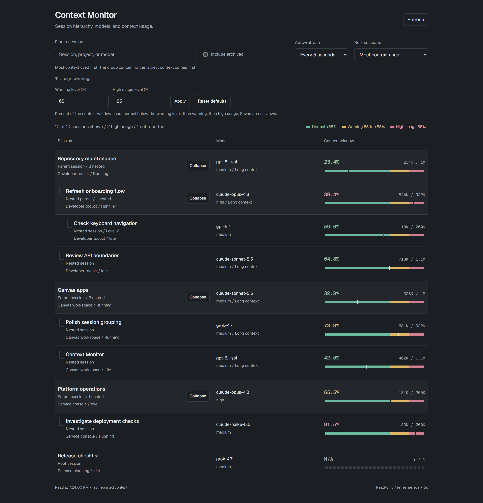

# Context Monitor

## Overview

A single view of your GitHub Copilot app sessions, models, and context windows. See which sessions are nearing their capacity without opening a separate monitor for each one.

| Control | What it does |
| --- | --- |
| Expand / Collapse | Reveal or hide a parent's nested sessions, including grandchildren. |
| Find a session | Search by session name, project, model, or session ID. |
| Sort sessions | Order by activity, context used, percentage used, window capacity, or name. |
| Auto-refresh | Choose automatic reads every 5s, 10s, 30s, 1m, or 5m, or turn them Off. |
| Usage warnings | Set the percentages where Warning and High usage begin. |
| Apply / Reset defaults | Save warning levels or restore 65% / 85%. |
| Session name | Inspect exact token counts, limits, and available breakdowns. |
| Include archived | Show archived sessions alongside current ones. |
| Refresh | Read the latest app metadata immediately. |

Parents have shaded rows, **Parent session** labels, and total nested-session counts. Children appear underneath with connectors, indentation, and **Nested session** or **Nested parent** labels. Top-level branches start collapsed; expansion choices survive refreshes.

The segmented strip shows the **Normal**, **Warning**, and **High usage** ranges on a 0-100% scale. Its contrasting marker shows actual context usage; a fully colored strip does not mean the window is full. Missing usage is **N/A**, with a neutral dashed strip and no marker. Usage above 100% keeps its exact percentage while the marker stops at the right edge.

## Preview



High-resolution mock experience rendered from the actual canvas at **2880 x 3000 pixels**. It shows **10 sessions**, three parent groups, nested children and a grandchild, and **six models across Claude, GPT, and Grok**. Normal, warning, high-usage, running, idle, and unavailable states appear together.

All session names, projects, token counts, and activity in this image are synthetic; no personal metadata is included. Model names illustrate the layout, not guaranteed availability for an account.

## Use in GitHub Copilot

Requires GitHub Copilot app with CLI canvas extensions, locally accessible app metadata, and a Node runtime supporting `node:sqlite` (Node 24 recommended).

In a Copilot chat, ask:

> Install this personal canvas extension as `context-monitor` from https://github.com/likamrat/ghcp-canvas-apps/tree/main/apps/context-monitor, then open Context Monitor.

Review the installation approval. User scope makes the monitor available across chats. The repository also includes a project discovery entry in `.github/extensions/context-monitor/extension.mjs` for developing the app here. A project installation shadows a user installation with the same name.

**Sorting and search.** Recent activity is the default. Most/Least context used compares token counts; Highest/Lowest % used compares how full the windows are; Largest context window compares input capacity; Name offers A-Z and Z-A. Sessions or groups without reported values go last in either direction.

Parents and nested sessions stay together. Context-based sorts rank groups by their highest or lowest matching value and expand the hierarchy so the relevant child is visible. You can collapse branches afterward. Search keeps a match's ancestors visible, even through collapsed branches; clear search to return to your expansion choices. Non-matching children do not influence search ordering.

**Usage warnings.** Open Usage warnings, enter whole percentages from 0 to 100, and choose Apply. Warning must be lower than High usage. Defaults are 65% and 85%; Reset defaults saves those values and replaces unsaved edits. The legend, strips, row colors, and high-usage count update together. These levels are visual warnings, not predictions of when Copilot will compact a conversation.

**Auto-refresh** offers **Off**, **5 seconds** (default), **10 seconds**, **30 seconds**, **1 minute**, and **5 minutes**. Refreshing pauses while the canvas is hidden. Changing the interval restarts the countdown; each countdown begins after the previous read finishes, so requests never overlap. **Off** disables automatic reads, including on returning to the canvas; **Refresh** still reads immediately. The canvas always reads once when opened.

**Session details.** Select a session name to inspect exact context counts, input/output limits, and any reported system, conversation, tool, MCP, and buffer counts. Archived sessions are hidden initially. Nested counts include all non-archived descendants, or archived descendants too when included, regardless of search.

Closing the canvas stops its server; reopening it reads the same app metadata and restores the default interval. No hosted site or GitHub Pages deployment is needed.

## Data

The extension opens `$COPILOT_HOME/data.db` in SQLite read-only mode; `COPILOT_HOME` defaults to `~/.copilot`. It reads selected session, workspace, project-name, parent-link, alias, and context-sample fields. It does not read prompts, conversations, credentials, session event logs, or repository code, and does not modify the database. Metadata is served only over a token-protected loopback endpoint, with no third-party requests.

This is an **app-specific local database adapter**, not a public cross-session SDK API. It checks required schema fields and reports missing/incompatible stores instead of manufacturing data. It works on the machine hosting `data.db`; a remote or cloud extension without that database cannot enumerate the desktop app. Remote sessions appear if the local app has synchronized their metadata.

Context values are the app's **last reported snapshot**, not lifetime token totals or an independently calculated live estimate. The last context-sample timestamp is shown when available. Idle/archived sessions may have old samples. Breakdown fields may be absent or overlap; the monitor does not sum them into a fabricated total.

Workspace bindings and historical CLI aliases are normalized into one app session. Project children use workspace creator links; chat children use chat/side-chat parent links. Detached sessions remain roots; fork ancestry is not treated as nesting. A missing or hidden archived parent promotes its visible child to the root. Cyclic links are detached with a warning.

No session metadata is committed or saved by this extension. Color preferences are saved locally in `$COPILOT_HOME/extensions/context-monitor/artifacts/settings.sqlite` and shared across Context Monitor views, sessions, and restarts. Only this separate preferences database is writable; the Copilot app database stays read-only. Simultaneous edits are version-checked, and conflicts preserve your draft for review rather than silently overwriting another view's settings. Other open views pick up saved changes on their next refresh.

Search, sort order, collapse, detail expansion, archive visibility, and refresh interval are transient per-view settings.

## Develop

From this app's folder:

```sh
node --test monitor.test.mjs
```

No packages or build step are required. Copilot supplies `@github/copilot-sdk`. Reload extensions after editing, then open **Context Monitor**. The agent-facing `snapshot` action reads the same metadata and configured context colors as the UI. `get_settings` reads the thresholds, defaults, and version; `set_thresholds` saves an explicitly requested change using that version.

| File | Responsibility |
| --- | --- |
| `extension.mjs` | Canvas lifecycle and snapshot/settings actions. |
| `index.html`, `app.js`, `style.css` | Rendering, hierarchy, sorting, refresh controls, and warning settings. |
| `server.mjs` | Local HTTP routes and request checks. |
| `source.mjs` | Read-only Copilot app database adapter. |
| `model.mjs` | Usage levels, hierarchy, search, and sort presets. |
| `settings.mjs` | Versioned local warning preferences. |
| `monitor.test.mjs` | Synthetic data, renderer, persistence, and HTTP tests. |
| `fonts/` | Bundled Geist fonts and their license. |

The UI uses documented host color tokens, light/dark fallbacks, keyboard-accessible controls, and responsive rows. Typography uses locally bundled **Geist Sans** and **Geist Mono**, with 15px session names and 14px body text.

The unmodified variable WOFF2 fonts in `fonts/` come from [Vercel's Geist](https://github.com/vercel/geist-font), distributed in the `geist` 1.7.2 package under the SIL Open Font License 1.1. Their copyright notice and license are in `fonts/LICENSE.txt`. No font CDN requests or runtime packages are needed.

Tests use disposable synthetic SQLite fixtures and cover warning levels, preference persistence/reset/conflicts, unknown telemetry, nesting, search, all sorting presets, aliases, archives, schema errors, read-only behavior, and HTTP access restrictions. Renderer tests use a controlled clock to verify refresh intervals, Off/manual mode, hidden-canvas pausing, in-flight changes, and hierarchy controls.

## Publish

Keep the source, screenshot, and this README together in `apps/context-monitor/`. Commit and push to this repository's `main` branch to update the installation URL, then install or update the personal extension in Copilot.

Keep the preview synthetic. Do not commit app databases, session metadata, preferences, logs, or screenshots containing personal session names. Update the [root catalog](../../README.md) if the app's description or installation instructions change.
