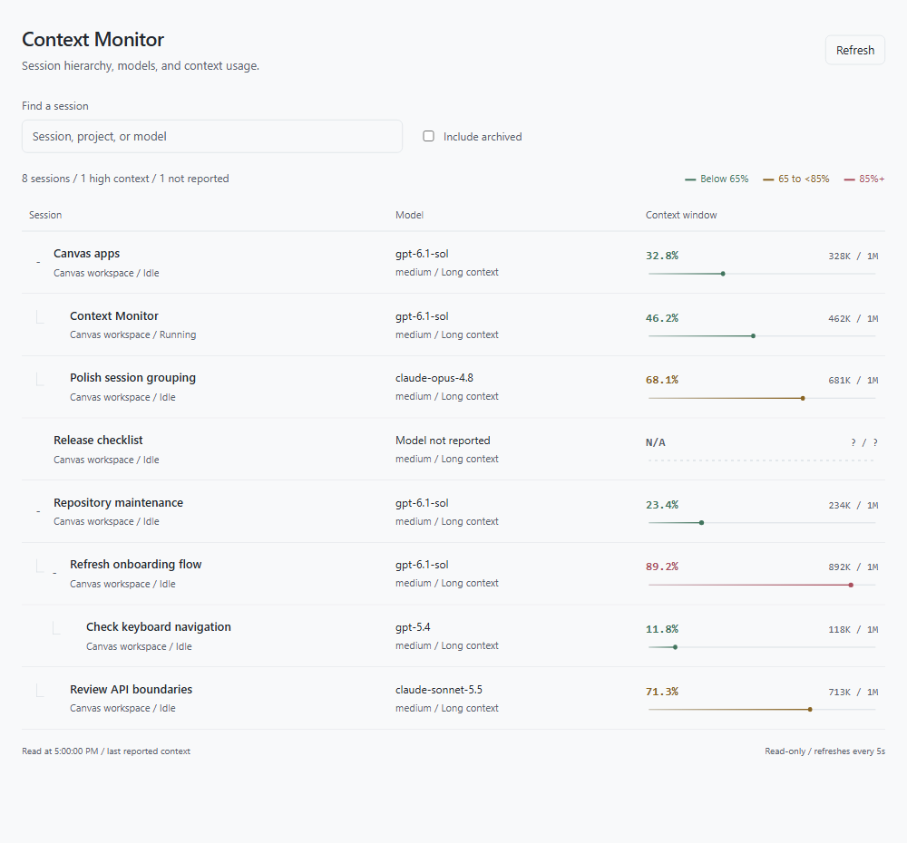

Context Monitor shows which Copilot sessions are nearing their context limit, so you can decide where to keep working and where to start fresh.



## Install

Paste this into a GitHub Copilot app chat:

```text
Install or update Context Monitor as a persistent personal canvas extension from:
https://github.com/likamrat/ghcp-canvas-apps/tree/main/apps/context-monitor

Reuse the existing installation and preserve saved settings.
Reload extensions, verify Context Monitor appears in Canvas apps, and open it.
```

## Use

Scan the heat map or select a session for details. Filter by model or usage, and adjust warning levels under **Usage settings**. The heat map covers all matching sessions, not just the current page.

Input and output totals cover the whole session. The context reading shows how much of the current window is in use.

Context Monitor reads local app metadata without changing it. It doesn't read or upload conversations.
