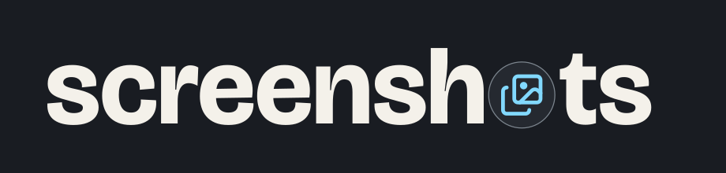

<p align="center">
  
</p>

# Screenshots

Browse, preview, and download screenshots from your Copilot sessions.

<a href="screenshot.png"></a>

[Zoom preview](screenshot-preview.png). Screenshots use sample data.

## Install

Paste into a GitHub Copilot chat once published to `main`:

```text
Install or update this as a persistent personal canvas extension:
https://github.com/likamrat/ghcp-canvas-apps/tree/main/apps/screenshots

Preserve existing data. Reload extensions and verify Screenshots appears in
Canvas apps as "Canvas · Personal" with "New session". If you cannot inspect
the list, say so. Then open Screenshots.
```

## Use

Opens with the current Copilot session selected. You can choose another session in the navigator.

- Search sessions and expand parents. **Include child screenshots** adds their images to the gallery.
- Filter by filename, source, or date; sort and group results. Pages show **8**, **16**, or **32** images.
- Select an image to zoom. **Reset zoom** restores its opening size; **Actual size** shows 100%. Arrow keys navigate; Escape closes.
- Download one image or **Download all** filtered results as one ZIP. Files go to Downloads without overwriting existing files. **Open in folder** reveals the file; **Dismiss** hides the notice.

**Open in browser** uses your system browser. Keep the Copilot session running; extension reloads end the old browser connection.

## Data

Local only. Original images and session metadata stay unchanged. Supports PNG, JPEG, GIF, and WebP. Missing files can use a retained session image, sometimes resized; images without a local file or retained bytes remain unavailable. Remote files are not fetched.

**Tool image** means a tool returned the image for viewing; **Tool-generated** means a screenshot tool recorded its capture. **Unknown** is reserved for references without tool provenance.

Dates use local time and labeled event/file timestamps. Previews are limited to 32 MiB; ZIPs to 128 MiB. Discovery limits produce warnings.

## Develop

Node 24+. No build step. From this folder:

```sh
node --test model.test.mjs source.test.mjs server.test.mjs downloads.test.mjs
```

Reload extensions after edits. Keep private images, histories, and databases out of the repository.

Logo: Lucide **Images** ([license](icons/LICENSE)) and Bricolage Grotesque ([license](FONT-LICENSE.txt)).
