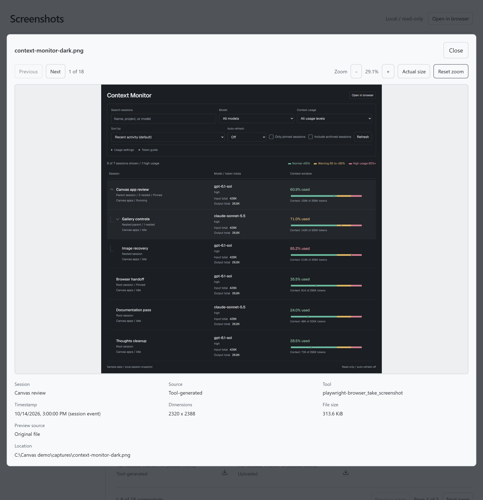

<p align="center">
  
</p>

When screenshots pile up across Copilot sessions, finding the one you need means digging through old chats. Screenshots gives you a visual history of each session so you can find the image and get back to your work.

<a href="screenshot.png"></a>

<a href="screenshot-preview.png"></a>

## Install

Screenshots runs as a personal canvas extension in the GitHub Copilot app. Paste this into a chat:

```text
Install or update this as a persistent personal canvas extension:
https://github.com/likamrat/ghcp-canvas-apps/tree/main/apps/screenshots

Reuse an existing installation and preserve its data.
Reload extensions in the GitHub Copilot app and verify Screenshots appears
in Canvas apps as "Canvas · Personal" with "New session". If you cannot inspect
the list, say so. Then open Screenshots.
```

## Use

Opens with the current Copilot session selected. You can choose another session in the navigator.

- Search sessions and expand parents. **Include child screenshots** adds their images to the gallery.
- Filter by filename, source, or date; sort and group results. Pages show **8**, **16**, or **32** images.
- Set **Auto-refresh** to 5, 10, or 30 seconds, 1 minute, or 5 minutes. It starts off, pauses when hidden, and keeps your filters, session, and page.
- Select an image to zoom. **Reset zoom** restores its opening size; **Actual size** shows 100%. Arrow keys navigate; Escape closes.
- Download one image or **Download all** filtered results as one ZIP. Files go to Downloads without overwriting existing files. **Open in folder** reveals the file; **Dismiss** hides the notice.

**Open in browser** uses your system browser. Keep the Copilot session running; reloading extensions in the GitHub Copilot app ends the old browser connection.

## Data

Local only. Original images and session metadata stay unchanged. Supports PNG, JPEG, GIF, and WebP. Missing files can use a retained session image, sometimes resized; images without a local file or retained bytes remain unavailable. Remote files are not fetched.

**Tool image** means a tool returned the image for viewing; **Tool-generated** means a screenshot tool recorded its capture. **Unknown** is reserved for references without tool provenance.

Dates use local time and labeled event/file timestamps. Previews are limited to 32 MiB; ZIPs to 128 MiB. Discovery limits produce warnings.

## Develop

Node 24+. No build step. From this folder:

```sh
node --test model.test.mjs source.test.mjs server.test.mjs downloads.test.mjs refresh.test.mjs
```

After updating an installed copy, reload or restart the extension in **Customize** in the GitHub Copilot app. Alternatively, ask Copilot to "reload extensions". Reopen existing browser tabs to load the current code and favicon. Keep private images, histories, and databases out of the repository.
