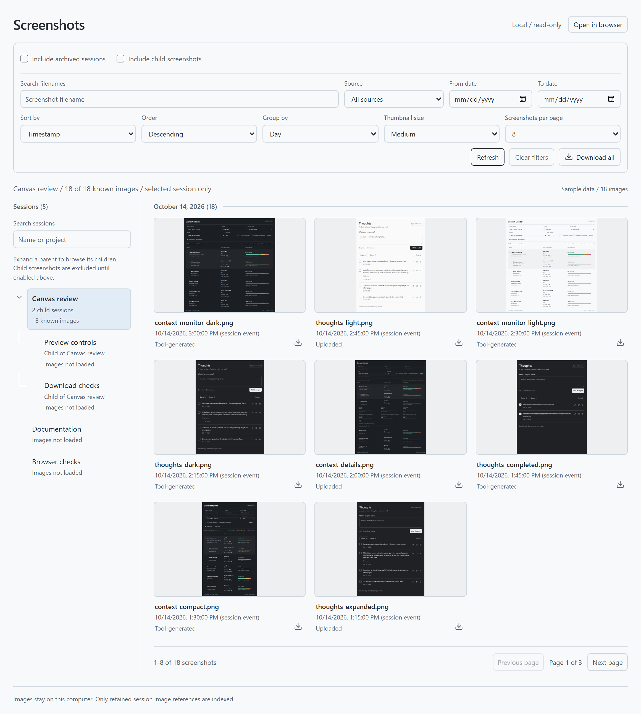

# Screenshots

Browse uploaded images and tool screenshots by GitHub Copilot session, without changing the originals.

<a href="screenshot.png"></a>

[Preview and zoom controls](screenshot-preview.png). Images use sample data.

## Use in the GitHub Copilot app

Paste this into a chat after the app is published to `main`:

```text
Install or update Screenshots as a personal canvas extension from:
https://github.com/likamrat/ghcp-canvas-apps/tree/main/apps/screenshots

Use persistent personal (user) scope so it is available across projects and chats.
Reuse an existing installation and preserve saved data and settings.
Reload extensions, verify the personal canvas registration, and confirm Screenshots
appears in Canvas apps as "Canvas · Personal" with "New session".
If you cannot inspect that list, say so. Then open Screenshots.
```

Search sessions beside the navigator; matching results appear as you type. Expand a parent to browse its children. **Include child screenshots** changes the gallery scope, not the expanded branches. Archived sessions are hidden by default.

- Filter by filename, source, or local date range. Sort by timestamp, filename, or size; group by day, source, or neither.
- Browse **8 screenshots per page**, with **16** and **32** options. Refresh keeps valid filters and page selection; Clear filters returns to page 1.
- Open a thumbnail for **Zoom**, **Reset zoom**, and **Actual size** (100%). Arrow keys move between images; Escape closes the preview.
- Download one image or use **Download all** for one ZIP of the filtered results across every page. Files go to your local Downloads folder without overwriting existing files. Notifications include **Open in folder** and **Dismiss**.

**Open in browser** uses your normal system-default browser, with a local favicon. Closing the canvas leaves that view running; keep the owning Copilot session active. Extension reload ends the old browser URL. Filters are independent between views.

## Data

Reads local Copilot metadata and retained image references. Supports PNG, JPEG, GIF, and WebP uploads, screenshot-tool results, and retained binary image assets. Parent links and historical session aliases are resolved before selecting image scope.

Missing originals can use a **Retained session image**, which may be resized. Missing files without retained bytes stay unavailable. Inline results without retained bytes and remote/cloud files cannot be recovered. Whole workspaces and conversation prose are not indexed.

Times use the session event timestamp, falling back to labeled file modification time. Dates use the local timezone. Previews are limited to 32 MiB and 100 million pixels; ZIPs to 128 MiB. Discovery limits, including 64 MiB per history and 128 MiB per scope, produce visible warnings.

No images or conversations are uploaded. Original files and app metadata stay unchanged. Downloads are created only on request. View state is temporary; keep live browser URLs private.

## Develop

Use Node 24 or later and the GitHub Copilot app with canvas extension support. No build or package installation is needed.

From this app's folder:

```sh
node --test model.test.mjs source.test.mjs server.test.mjs downloads.test.mjs
```

Cross-app browser and favicon checks are in `tests/`. Reload extensions after editing an installed copy.

Canvas ID: `screenshots`. Read-only actions: `list_sessions`, `query_images`, and `get_image`. The app folder is independently installable, like Thoughts and Context Monitor.

Icons use [Lucide](https://lucide.dev) ([license](icons/LICENSE)).

## Publish

Keep source, assets, and this README in `apps/screenshots/`. Publish to `main`, then update installed copies. Keep private screenshots, databases, histories, and logs out of the repository.
