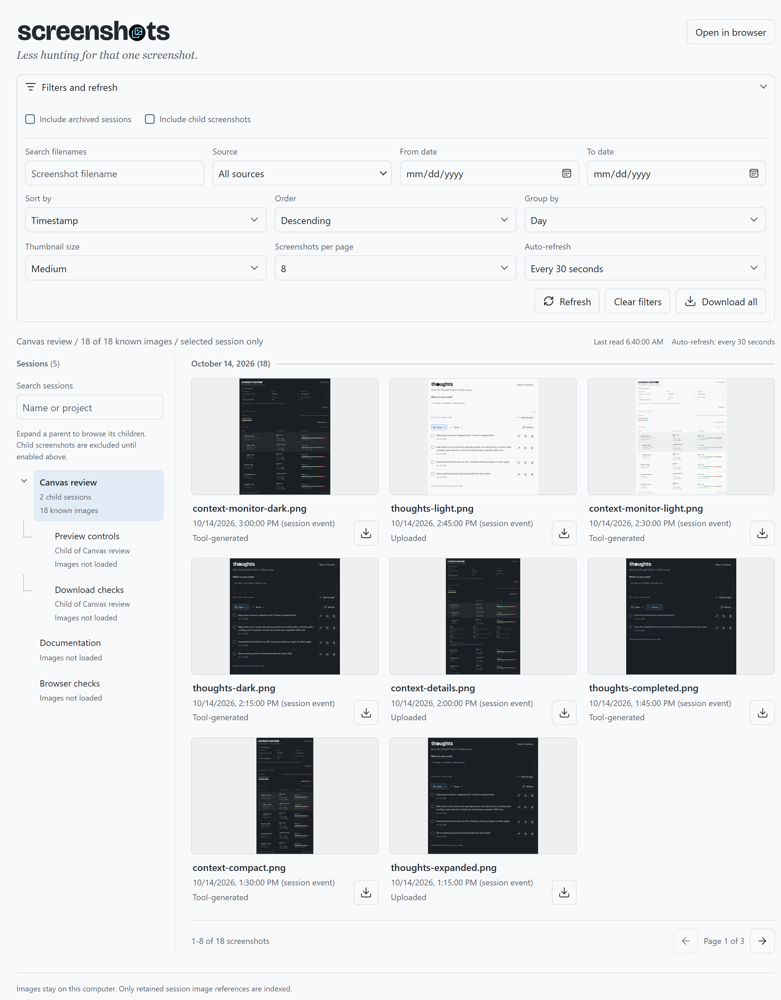
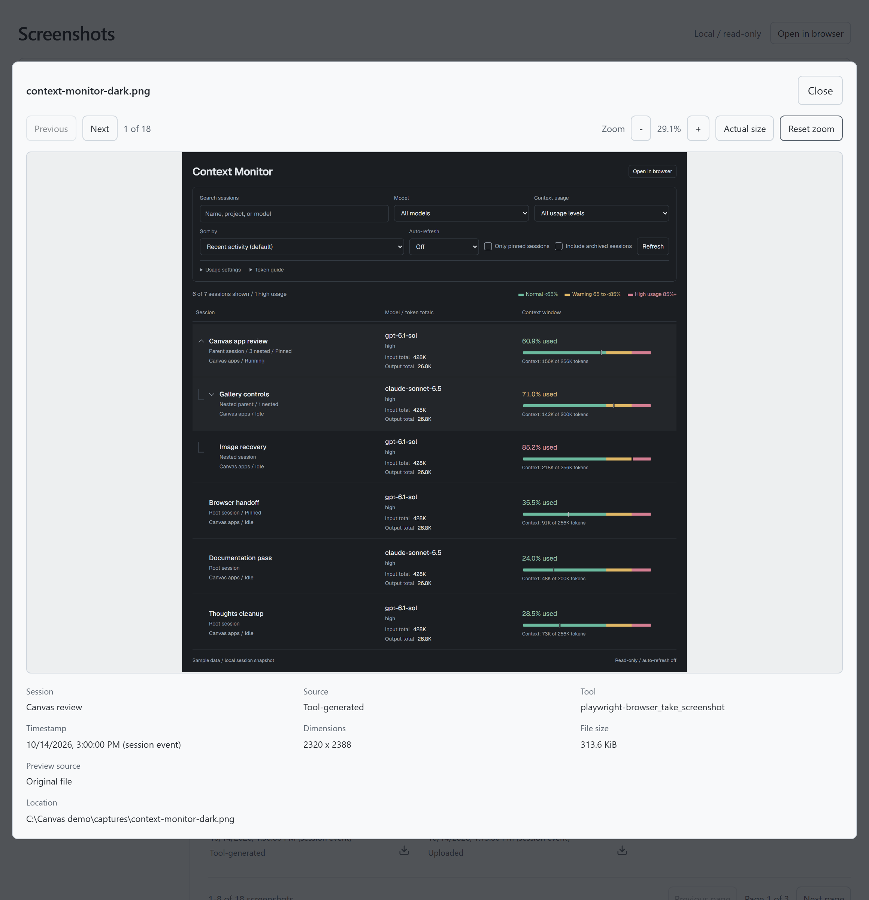

When screenshots pile up across Copilot chats, browse them by session instead of digging through the conversation.





## Install

Paste this into a GitHub Copilot app chat:

```text
Install or update Screenshots as a persistent personal canvas extension from:
https://github.com/likamrat/ghcp-canvas-apps/tree/main/apps/screenshots

Reuse the existing installation and preserve its data.
Reload extensions, verify Screenshots appears in Canvas apps, and open it.
```

## Use

Choose a session and filter the gallery. Open an image to zoom in. **Include child screenshots** adds images from the selected session's children.

Download one image or all filtered results as a ZIP, including matches on other pages. Existing downloads are not overwritten.

Images stay local and unchanged. If an original is missing, Screenshots can use a copy saved with the session. It doesn't fetch remote files.
