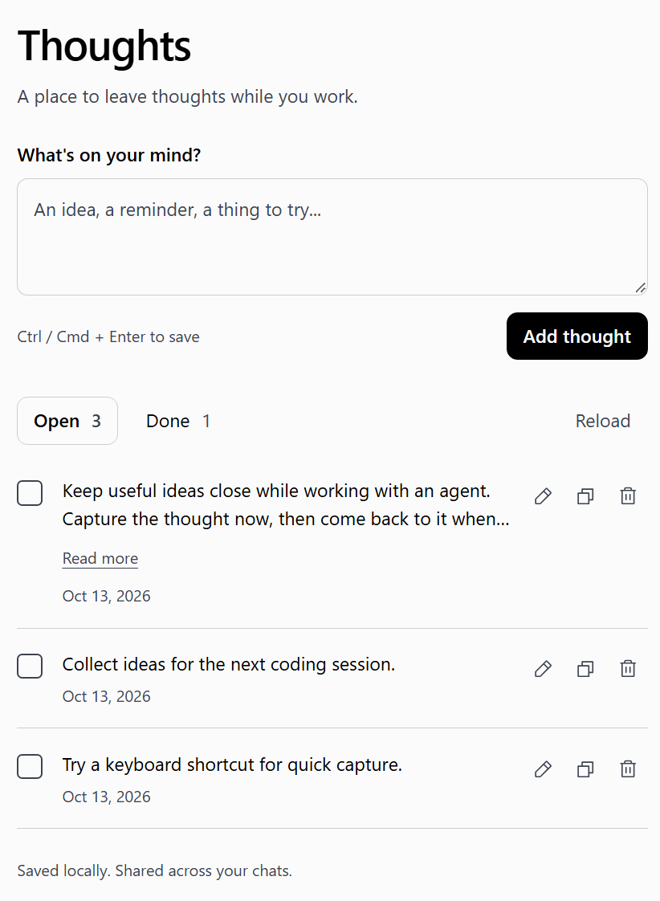

# Thoughts

Capture ideas in a canvas inside the GitHub Copilot app. Expand long thoughts, edit them, copy the full text, mark them done, or delete them.



## Use in the GitHub Copilot app

Paste this into a chat in the GitHub Copilot app:

```text
Install or update Thoughts as a personal canvas extension from:
https://github.com/likamrat/ghcp-canvas-apps/tree/main/apps/thoughts

Open Thoughts when installation is complete.
```

Choose **Add thought** or press **Ctrl/Cmd + Enter** to save an idea. You can also tell your agent what to save.

The bin icon asks for confirmation before permanently deleting a thought.

## Data

Thoughts are saved locally in SQLite and shared across chats. They stay on your computer when you close the canvas or restart the app.

## Develop

Use the GitHub Copilot app with canvas extension support and Node 24 or later. No build step or package installation is needed.

Run tests from this app's folder:

```sh
node --test store.test.mjs
```

Reload extensions after editing an installed copy.

Icons use [Phosphor Icons](https://github.com/phosphor-icons/core) under MIT ([license](PHOSPHOR-LICENSE.txt)).

## Publish

Keep the source, assets, and this README in `apps/thoughts/`. Push changes to `main`, then update the installed extension in the GitHub Copilot app.

Keep saved thoughts, databases, and logs out of the repository.
