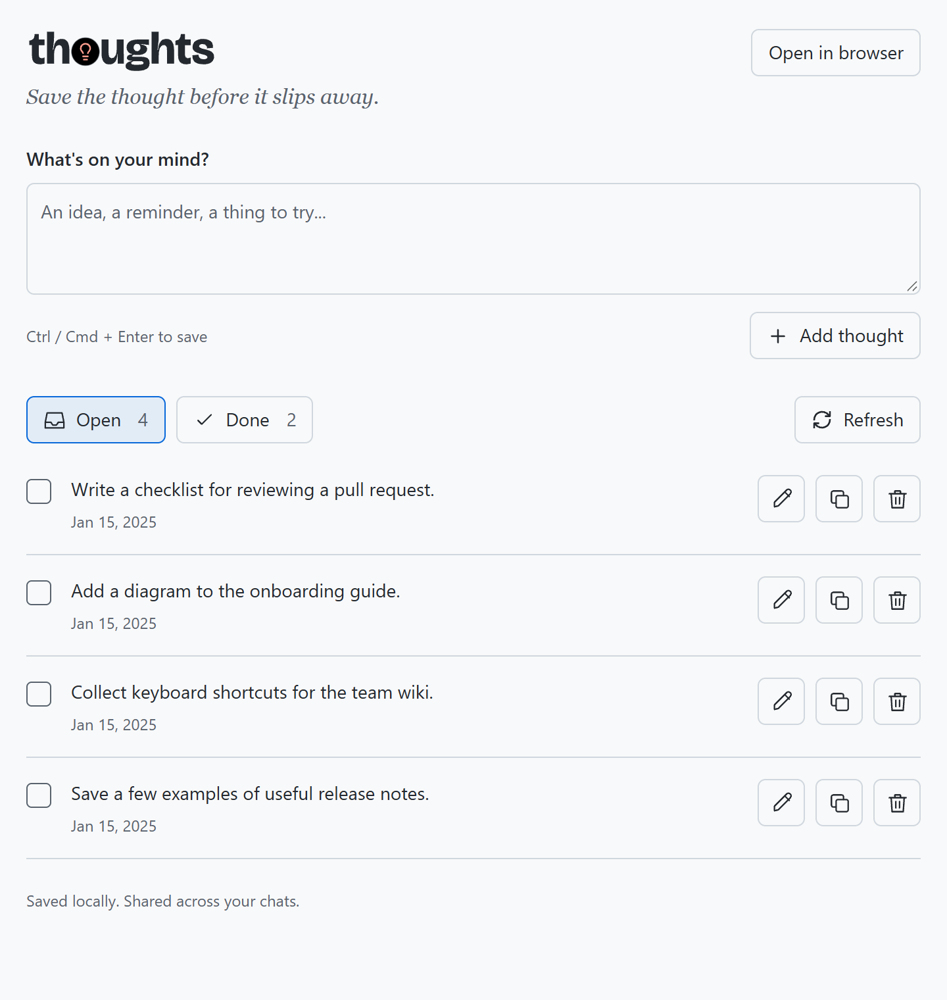

Ideas often show up while you're in the middle of something else. Save them in Thoughts and come back to the same list from any Copilot chat on this computer.



## Install

Paste this into a GitHub Copilot app chat:

```text
Install or update Thoughts as a persistent personal canvas extension from:
https://github.com/likamrat/ghcp-canvas-apps/tree/main/apps/thoughts

Reuse the existing installation and preserve saved thoughts.
Reload extensions, verify Thoughts appears in Canvas apps, and open it.
```

## Use

Type a thought, then choose **Add thought** or press **Ctrl+Enter** (**Cmd+Enter** on Mac). You can edit or copy the thought from its row.

Check a thought off to move it from **Open** to **Done**. To bring it back, open **Done** and uncheck it. Deleting a thought asks for confirmation.
