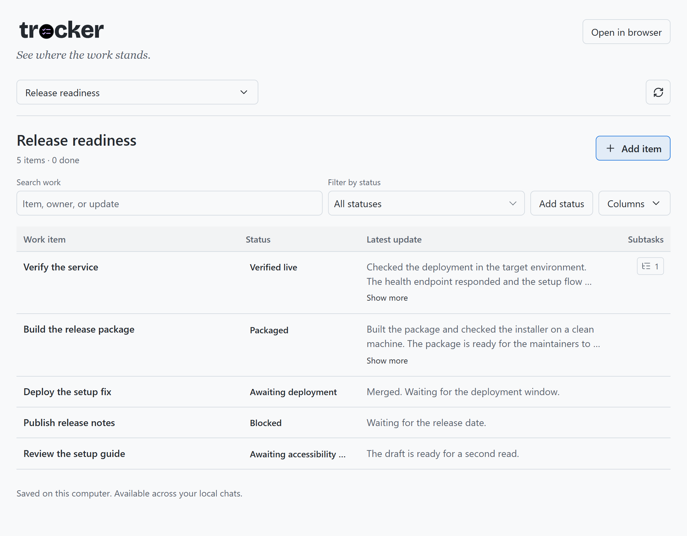
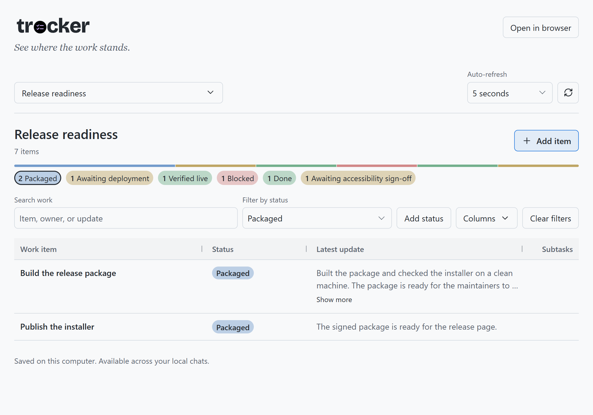
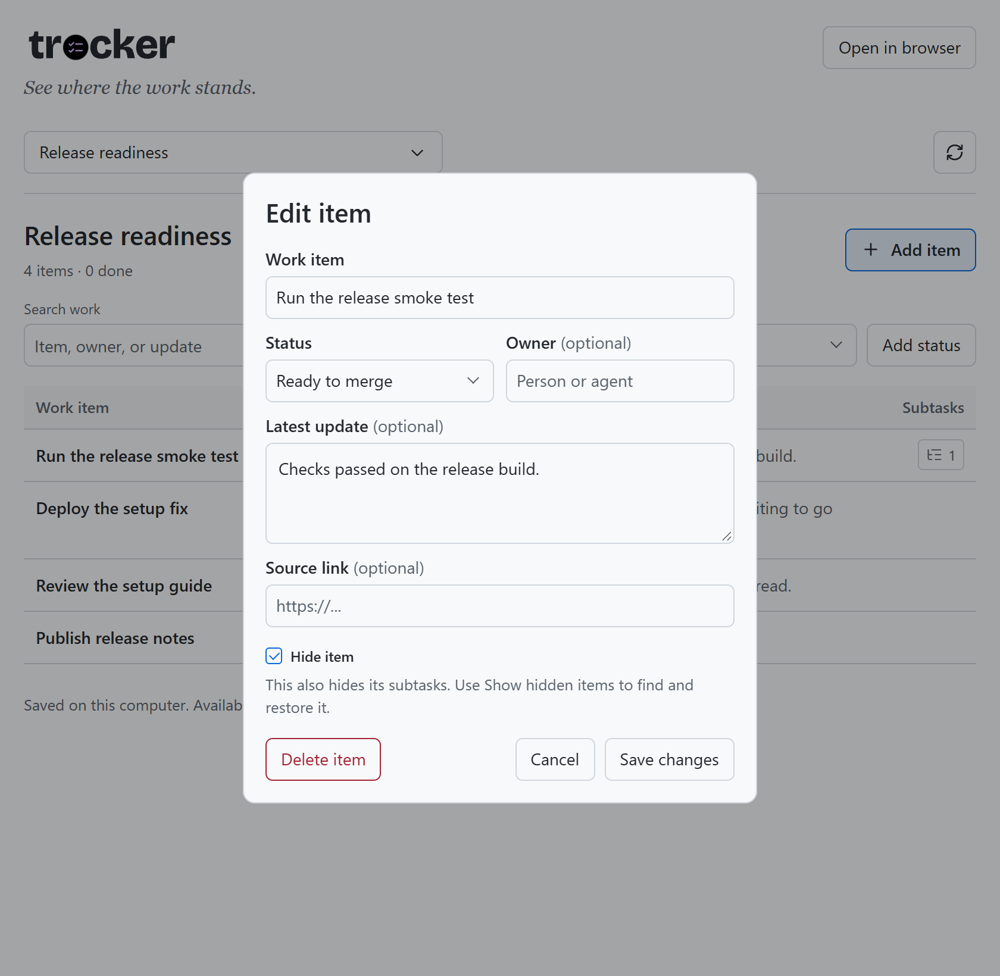
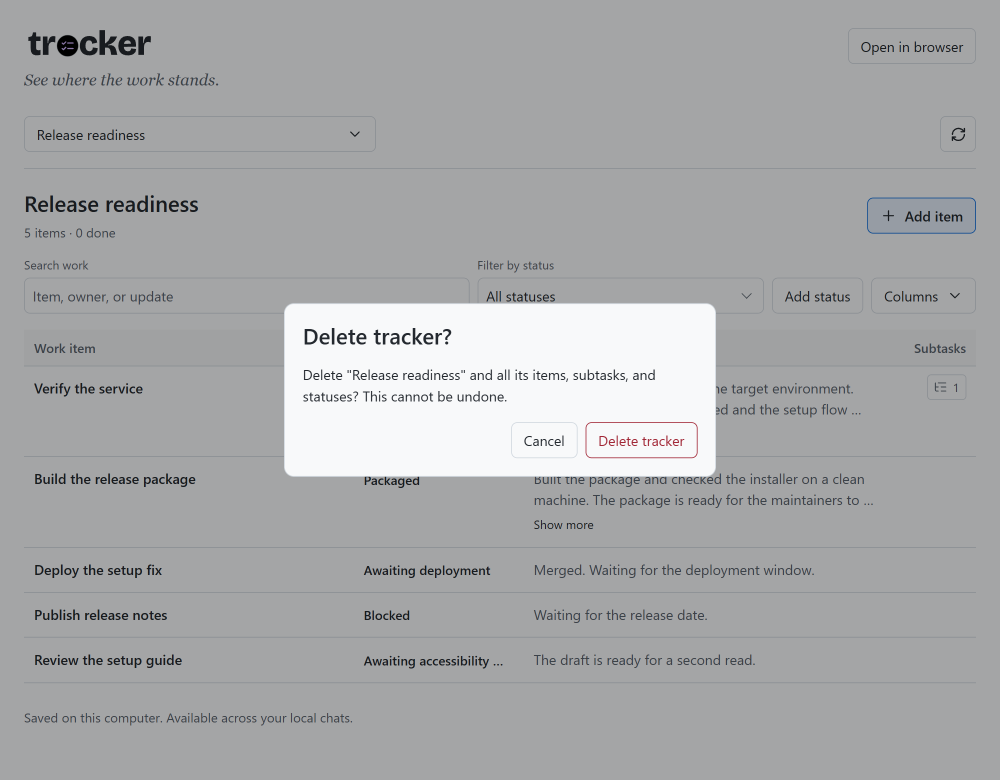

Keep a work list for a release, a handoff, or your own projects. Update it in the canvas or ask Copilot to update it from a chat.



## Use

### In the canvas

In the GitHub Copilot app, open **Canvas apps** and choose **Tracker**. If it isn't listed, [install it first](#install). Open the **Trackers** menu to create or open a list.

Choose **Add item** or select an item's title to edit it. Items can have an owner, an update, and a source link.

The bar and counts above the table show how the tracker's items are split by status. The summary counts top-level items, not subtasks. Search and status filters only change the table. Hidden items count only while **Show hidden items** is on.

New items start at **To do** unless a status filter is active. The table and summary use the same tinted tags with neutral text in light and dark themes. **In progress** and **Awaiting deployment** are yellow, **Packaged** is blue, **Verified live** and **Done** are green, and **Blocked** is red. **To do** and custom statuses without an assigned color use slate. Hover over a status in the table or focus it with the keyboard to see the full label and what it means. Use **Add status** for a custom label and an optional tip. [See all statuses](actions.md#built-in-statuses).

To add a subtask, pick a parent in **Add under**. Subtasks start collapsed. Use the count in the **Subtasks** column to open them. **Expand all** appears when more than one item has subtasks or when the **Subtasks** column is hidden. If a subtask matches a search or filter, its parent appears without expanding. Each subtask has its own status.

Link a Copilot session when you create a tracker or from the **Trackers** menu. The session name appears above the table and groups trackers in the menu. Choose **No session linked** to unlink it. Linking doesn't make plans, pull requests, or sessions update your tracker automatically.

#### Refresh the tracker

**Auto-refresh** checks for changes from other chats every 5 seconds by default. Choose a slower interval or **Off** for this view. Automatic checks pause while the view is hidden or you're editing an item. Use **Refresh trackers** to check immediately. Changes you save in this view update the table and summary even when auto-refresh is off.

#### Filter and adjust the table

Search titles, owners, and updates, or use **Filter by status**. Use **Columns** to show or hide Status, Latest update, and Subtasks.

Select a status tag above the table to filter by that status. Select it again to remove just the status filter, or choose **Clear filters** to reset both search and status. The summary counts don't change as you filter.



Drag the short mark between column headers to resize the two columns. You can also focus it and press the left or right arrow key, or click it and choose **Narrower** or **Wider**. Widths apply to the current view. To restore the defaults, choose **Columns** → **Reset column widths**.

Long updates start at two lines. Choose **Show more** to read the full update and **Show less** to collapse it. Search still checks the full update.

#### Hide or delete work

Select an item's title to open its editor. Check **Hide item** and save to keep it out of the list without deleting it. Hiding a parent also hides its subtasks. To restore an item, turn on **Show hidden items**, open the item, clear **Hide item**, and save.



To delete one item, choose **Delete item** in its editor and confirm. If the item has subtasks, delete those first. To delete the whole list, choose **Delete tracker** from the tracker menu and confirm. This permanently deletes its items, subtasks, and statuses.



### With a Copilot prompt

#### Track work from a coding session

Paste this into the session where the work is happening and replace `[tracker name]`.

```text
Use the Tracker Canvas app to record the work from this coding session in
[tracker name]. Open that tracker, or create it if it doesn't exist.

Add one item per distinct task, not one per chat message. Update matching
items instead of duplicating them, and leave unrelated items alone.
Set each status based on what happened in this session. Add a short update
with any blocker, next step, or relevant pull request link.
Show me the tracker when you're done.
```

To link the tracker to the session as well, add: "Link this tracker to the current Copilot session."

To open a saved tracker from any local chat, ask: "Open the Release readiness tracker in Tracker."

#### Turn Thoughts into work items (optional)

Paste this into Copilot with both [Thoughts](../thoughts/README.md) and Tracker installed. Name a few thoughts, ask for all open thoughts, or ask for every saved thought, including completed ones.

```text
Turn [which thoughts to use] from Thoughts into work items in [tracker name].
Give each distinct task a clear title and keep useful context in its update.
Set new items to To do and skip duplicates. Ask before adding anything if
the tracker is missing or a thought doesn't describe a task. Leave Thoughts unchanged.
```

## Install

To install Tracker or update an existing copy, paste this into a local Copilot chat. It makes Tracker available across your local chats without creating a tracker or linking one to the current session.

Publishing a change to GitHub does not update your installed copy. After updating Tracker, reopen any Tracker canvas that was already open.

```text
Install or update Tracker as a persistent personal canvas extension from:
https://github.com/likamrat/ghcp-canvas-apps/tree/main/apps/tracker

Keep my saved trackers, reload extensions, and open Tracker. Don't create
a tracker or link one to this session.
```

[Canvas actions and status IDs](actions.md)
