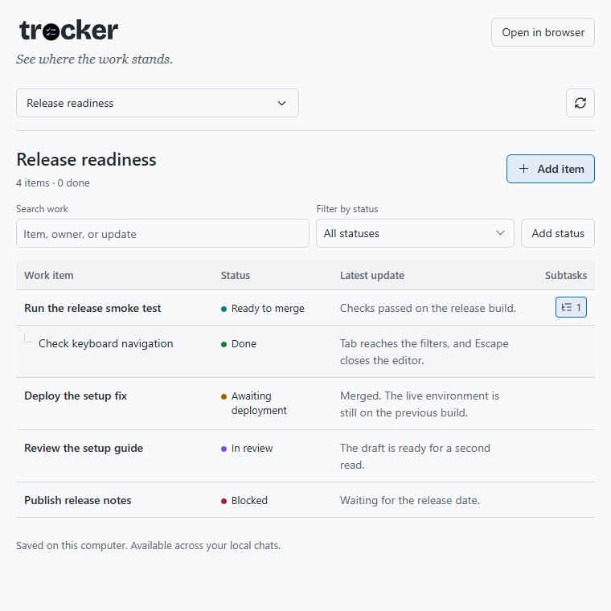

Keep a work list for a release, a handoff, or your own projects. Update it in the canvas or ask Copilot to update it from a chat.



## Install

Paste this into a local Copilot chat. It installs Tracker for all your local chats without creating a tracker or linking one to the current session.

```text
Install or update Tracker as a persistent personal canvas extension from:
https://github.com/likamrat/ghcp-canvas-apps/tree/main/apps/tracker

Keep my saved trackers, reload extensions, and open Tracker. Don't create
a tracker or link one to this session.
```

## Use

Use the **Trackers** menu to create or switch trackers. Choose **Add item** or select an item's title to edit it. Items can have an owner, an update, and a source link. Search titles, owners, and updates, or use **Filter by status**.

New items start at **To do** unless a status filter is active. Hover over a status or focus it with the keyboard to see what it means. For example, **Awaiting deployment** means the change is merged and isn't live yet. Use **Add status** for a custom label and an optional hover tip. [See all statuses](actions.md#built-in-statuses).

To add a subtask, pick a parent in **Add under**. Subtasks start collapsed; use the count at the right of a row to open them, or **Expand all** when several rows have subtasks. If a subtask matches a search or filter, its parent appears without expanding. Each subtask has its own status.

Link a Copilot session when you create a tracker or from the **Trackers** menu. The session name appears above the table and groups trackers in the menu. Choose **No session linked** to unlink it.

Trackers stay on this computer and can be opened from other local chats. Plans, pull requests, and sessions don't update them automatically.

## Open Tracker from any chat

Replace `[tracker name]` with the name of a tracker you've already created:

```text
Open the Tracker Canvas app and show me the [tracker name] tracker.
If that tracker doesn't exist, show me the available trackers.
Don't create or link any tracker to this session.
```

To make an update, name the tracker and the item: "In Release readiness, mark the smoke test Ready to merge and link its pull request."

## Turn Thoughts into work items

Paste this into Copilot with both [Thoughts](../thoughts/README.md) and Tracker installed. Name a few thoughts, ask for all open thoughts, or ask for every saved thought, including completed ones.

```text
Turn [which thoughts to use] from Thoughts into work items in [tracker name].
Give each distinct task a clear title and keep useful context in its update.
Set new items to To do and skip duplicates. Ask before adding anything if
the tracker is missing or a thought doesn't describe a task. Leave Thoughts unchanged.
```

[Canvas actions and status IDs](actions.md)
